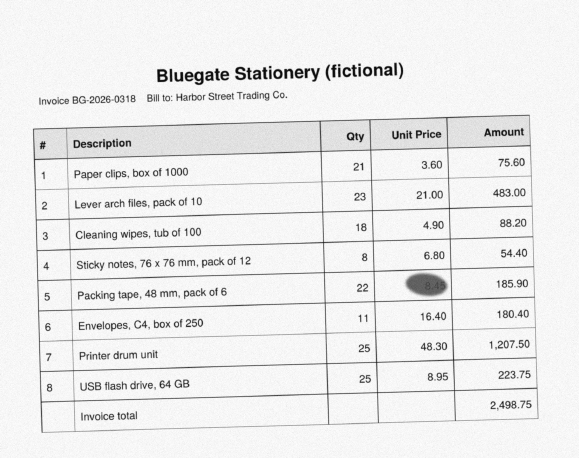
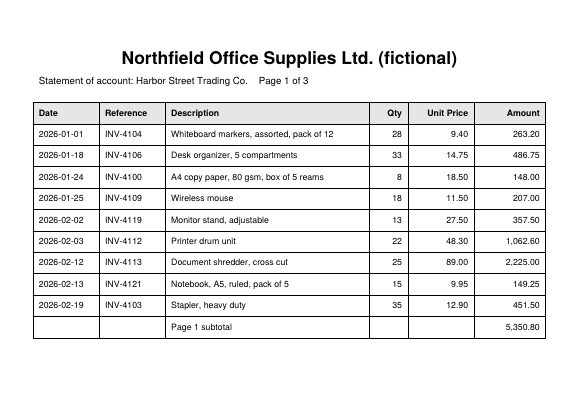

# PDF Table Extraction Demo

**Tables from text PDFs and scanned PDFs into one clean Excel workbook, with every number checked and every doubtful cell flagged instead of guessed.**

This is a small, self-contained demonstration. All documents are synthetic: the companies, items, and amounts are invented by `make_docs.py`, so there is no client data anywhere in this repository.

## The problem

Getting a table out of a PDF is easy when it works and expensive when it quietly goes wrong. A misread digit in an invoice looks exactly like a correct one. This demo is built around one rule:

> A value is either verified, or it is flagged. It is never silently "fixed".

## What it handles

| Document | Challenge | Method |
| --- | --- | --- |
| `supplier_statement.pdf` | One table running across 3 pages, with a repeated header, a subtotal on each page, and a grand total | Read directly from the text layer with pdfplumber |
| `scanned_invoice.pdf` | Image only, no text layer. Rotated about 1.6 degrees, blurred, noisy, with a stain covering one cell | Deskew, detect the table grid, OCR each cell separately with Tesseract |

**The scanned invoice (input)**



**Page 1 of the 3-page statement (input)**



## Results

Measured by `evaluate.py` against the ground truth the PDFs were generated from:

| Document | Cells | Correct | Left blank and flagged | Silently wrong |
| --- | --- | --- | --- | --- |
| Supplier statement (text PDF, 26 rows) | 156 | 156 | 0 | 0 |
| Scanned invoice (OCR, 8 rows) | 40 | 39 | 1 | 0 |

All five arithmetic checks pass: the three page subtotals, the statement total (8,865.80), and the invoice total (2,498.75) each equal the sum of the extracted rows.

The one cell that was not extracted is the stained unit price on invoice line 5. The output leaves it empty, highlights the row, and adds this note:

```
unit price: unreadable; line total cannot be verified;
amount / qty implies unit price 8.45, confirm before use
```

The implied value happens to be right, but it is offered as a suggestion for a person to confirm, not written into the data.

These numbers describe this demo only. Two clean synthetic documents say little about accuracy on real-world scans, which vary far more.

## How it works

1. **Route by document type.** If a PDF has a text layer, use it. OCR is only for pages that are images.
2. **Text path.** pdfplumber extracts the table on each page. Repeated headers are dropped, and subtotal and total rows are separated from line items so they can be used as checks.
3. **Scan path.**
   - Render the page at 200 dpi.
   - Estimate skew from the long table rules (Hough transform) and rotate the page level.
   - Find horizontal and vertical rules with morphological opening, which gives the cell boundaries.
   - OCR each cell on its own. Numeric columns are restricted to digits, comma, and period.
4. **Validate.** For every row, quantity times unit price must equal the amount to the cent. Rows must sum to the printed subtotals and totals.
5. **Flag.** A cell is flagged when it is unreadable, when OCR confidence is low, or when the row fails its arithmetic check.
6. **Write Excel.** One sheet per document, flagged rows highlighted, plus a Validation sheet listing each check.

## Output

`output/demo_extraction.xlsx` contains three sheets:

- **Statement:** 26 rows with page, date, reference, description, quantity, unit price, amount
- **Scanned invoice:** 8 rows, with line 5 highlighted and its review note
- **Validation:** printed value versus computed value for each of the five checks

`output/extraction.json` holds the same data for use in code.

## Run it yourself

Requirements: Python 3.10 or newer, plus two system tools.

```bash
# Ubuntu or Debian
sudo apt install tesseract-ocr poppler-utils

# macOS
brew install tesseract poppler
```

Then:

```bash
git clone https://github.com/saleemb94/pdf-table-extraction-demo.git
cd pdf-table-extraction-demo
pip install -r requirements.txt

python make_docs.py    # regenerate the synthetic PDFs and ground truth
python extract.py      # extract, validate, write the Excel workbook
python evaluate.py     # score the extraction against the ground truth
pytest                 # unit tests for the parsing and validation rules
```

The generated PDFs and the output workbook are committed, so you can inspect the results without running anything.

## Project layout

```
make_docs.py      builds the synthetic PDFs and ground truth
extract.py        extraction, validation, Excel output
evaluate.py       cell-level accuracy against the ground truth
input/            the two demo PDFs
truth/            the values the PDFs were generated from
output/           Excel workbook, JSON, accuracy summary
tests/            unit tests
docs/             images used in this README
```

## Limitations

- The scan path expects a ruled table, with visible lines between cells. Borderless tables need a different approach.
- OCR is English only here. Tesseract supports Arabic and other languages, but mixed right-to-left text needs extra handling that this demo does not include.
- Column meaning is assumed from position. A production version would detect headers.
- Handwriting is out of scope.

## License

MIT
